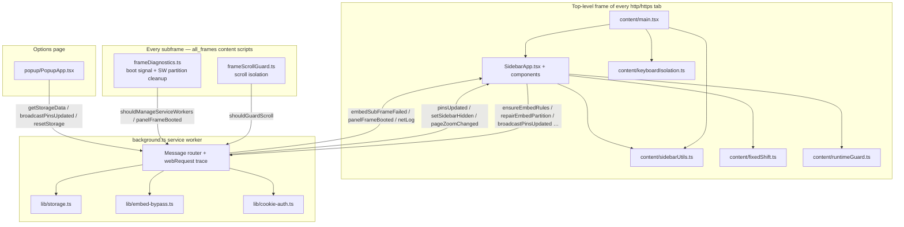

# browser-sidebar — Implementation Guide

How the extension works, for contributors (and agent sessions) who need to understand the repo without re-discovering its behavior from scratch.

**Contents**

1. [Overview](#1-overview)
2. [Architecture](#2-architecture)
3. [Source layout](#3-source-layout)
4. [Permissions](#4-permissions)
5. [Data model and storage](#5-data-model-and-storage)
6. [Content-script UI](#6-content-script-ui)
7. [User flows](#7-user-flows)
8. [Embed pipeline](#8-embed-pipeline)
9. [Message protocol](#9-message-protocol)
10. [Concurrency and race conditions](#10-concurrency-and-race-conditions)
11. [Limitations](#11-limitations)
12. [Debugging and testing](#12-debugging-and-testing)
13. [Extending the codebase](#13-extending-the-codebase)
14. [Related docs](#14-related-docs)

---

## 1. Overview

browser-sidebar is a **Chrome Manifest V3 extension** that adds a native-browser-style sidebar to normal web pages. It is **not** browser chrome: it injects UI into each page and shifts page content with CSS.

**Primary UX**

1. A **48px icon strip** on the left of every `http(s)` page (hide/show with the toolbar icon).
2. An expandable **panel** (300–1000px) that **overlays the page** (Opera GX popover style) and loads the clicked pin in an `<iframe>`. The panel is tried first for every pin; the background worker removes the headers that would block it (see [Embed pipeline](#8-embed-pipeline)).
3. If a site still can't render, the panel shows an **in-panel fallback view** with **Open in new tab** and **Repair & retry**. Nothing ever opens automatically.
4. **Inline settings** (gear icon): add/edit/delete/reorder pins, panel width, reset to defaults. The same features exist on the full-page options page.
5. **Instant switching**: up to 4 recently used panel iframes stay mounted but hidden ("warm frames"), and hovering a pin for 150ms preloads it.

### Why not a native sidebar?

Native browser sidebars render apps in **real top-level browsing contexts**, which `X-Frame-Options` / CSP `frame-ancestors` never apply to. Extensions cannot create such a context beside the page. They can only inject into pages, open tabs/windows, and rewrite network headers for hosts they have permission for. So the panel is an `<iframe>`, which is exactly the context sites like X, Instagram, and Discord block. The extension uses `declarativeNetRequest` (plus the other layers in §8) to undo those blocks for pinned domains only.

---

## 2. Architecture



`lib/pin-utils.ts`, `lib/defaults.ts`, and `lib/types.ts` are shared by all three contexts.

**Stack:** TypeScript (strict), React 19, SCSS, Vite 5 + `@crxjs/vite-plugin`. The content script mounts its React tree inside a **closed shadow root**. Vite keeps CSS class names unscoped (`generateScopedName: '[local]'`) so the shadow-DOM markup matches the SCSS selectors.

**Build:** `npm run build` writes `dist/`, which you load unpacked at `chrome://extensions`. `npm run dev` rebuilds on change, and `npm run typecheck` runs `tsc --noEmit`.

---

## 3. Source layout

| Path | Role |
|------|------|
| `manifest.json` | MV3 config: 3 content-script entries (below), service worker, `options_ui` |
| `src/background.ts` | Service worker: message router, embed-support sync (DNR rules + cookies) with signature fast path, toolbar toggle, zoom relay, partition repair, `webRequest` debug trace |
| **Content script (top frame)** | |
| `src/content/main.tsx` | Entry: injects page-shift CSS, creates `#browser-sidebar-host` + closed shadow root, mounts React |
| `src/content/SidebarApp.tsx` | Root component and all sidebar state: panel lifecycle, warm frames, embed verification, pin CRUD, resize, zoom, message handling |
| `src/content/components/IconStrip.tsx` | Pin buttons + gear; hover/press preload hooks; drag-to-reorder |
| `src/content/components/AppPanel.tsx` | Panel header, loading view, one iframe per warm frame, fallback view, resize handle |
| `src/content/components/SettingsPanel.tsx` | Inline settings UI (form state owned by `SidebarApp`) |
| `src/content/sidebarUtils.ts` | Host-page side: page-shift stylesheet, `<html>` layout classes, CSS variables, zoom compensation, initial storage load |
| `src/content/fixedShift.ts` | Shifts viewport-anchored page elements (fixed / ICB-absolute) right of the strip |
| `src/content/keyboardIsolation.ts` | Stops host-page shortcuts from swallowing sidebar form input |
| `src/content/runtimeGuard.ts` | Extension-context invalidation guards |
| `src/content/sidebar.module.scss` | Shadow-DOM styles (dark theme), inlined via `?inline` |
| `src/content/page-shift.module.scss` | Global host-page styles: `html` margin + `--browser-sidebar-shift` |
| **Content scripts (every subframe)** | |
| `src/content/frameScrollGuard.ts` | Pinned-origin frames get `overscroll-behavior: contain` |
| `src/content/frameDiagnostics.ts` | Pinned-origin frames: boot signal (`panelFrameBooted`), partitioned-SW cleanup; all frames: DEBUG diagnostics |
| `src/content/frameAudio.ts` | Pinned-origin panel frames: `postMessage` to the parent when `<audio>`/`<video>` starts or stops being audible; the sidebar badges hidden pins that are playing |
| **Shared library** | |
| `src/lib/types.ts` | `Pin`, `Settings`, `StorageData`, `PinFormState` |
| `src/lib/defaults.ts` | `BROWSER_SIDEBAR_DEFAULTS` (layout limits, default pins/settings), `browserSidebarClamp`, `browserSidebarGetDefaultStorageData` |
| `src/lib/storage.ts` | `chrome.storage.sync` read/write helpers |
| `src/lib/pin-utils.ts` | `resolveIconUrl`, `parsePinUrl`, `getUrlOrigin`, `computePinUrlSignature`, `getCurrentPagePinDefaults`, `reindexPins` |
| `src/lib/embed-bypass.ts` | Syncs the two `declarativeNetRequest` session rules (§8, layers 1–2) |
| `src/lib/cookie-auth.ts` | SameSite cookie relaxation + `cookies.onChanged` watcher (§8, layer 3) |
| **Other** | |
| `src/popup/*` | Full-page options UI (`options_ui`, opens in a tab). There is **no** toolbar popup: the toolbar icon toggles the sidebar |
| `icons/apps/*` | Default pin SVG icons (web-accessible) |
| `tests/e2e/*` | Playwright scripts, see [§12](#e2e-scripts) |

**Content-script entries**

| Script | Frames | Run at | Purpose |
|--------|--------|--------|---------|
| `main.tsx` | top only (`all_frames: false`; also self-guards `window.top !== window.self`) | `document_start` | Sidebar UI |
| `frameScrollGuard.ts` | all | `document_idle` | Scroll isolation for pinned embeds |
| `frameDiagnostics.ts` | all | `document_start` | Boot signal, SW partition cleanup, diagnostics |
| `frameAudio.ts` | all (reports only from direct children of top) | `document_start` | Audio-playing badge on hidden pins |

---

## 4. Permissions

| Permission | Used for |
|------------|----------|
| `storage` | Pins, settings, `lastActivePinId`, `sidebarHidden` in `chrome.storage.sync` |
| `scripting` | Fallback injection when the toolbar is clicked on a tab without the content script |
| `tabs` | `openTab`, broadcasting to all tabs, `getZoom` / `onZoomChange` |
| `windows` | Declared for tab/window management; no `chrome.windows.*` call exists in `src/` today |
| `cookies` | Re-writing pinned-site cookies to `sameSite: 'no_restriction'` (`lib/cookie-auth.ts`) |
| `declarativeNetRequestWithHostAccess` | Stripping framing response headers and rewriting `Sec-Fetch-*` for pinned domains (`lib/embed-bypass.ts`) |
| `webRequest` | Debug trace of every `sub_frame` request, plus forwarding real network failures as `embedSubFrameFailed` |
| `browsingData` | Partition repair (`repairEmbedPartition`) |
| `host_permissions: <all_urls>` | Content scripts on every page; required by the DNR rules and cookie access |

---

## 5. Data model and storage

```ts
interface Pin {
  id: string;       // "discord", or "custom-<timestamp>" for user pins
  name: string;     // ≤ 32 chars (form maxLength)
  url: string;      // normalized absolute URL (URL.href)
  iconUrl: string;  // extension-relative ("icons/apps/x.svg") or absolute http(s); may be ""
  order: number;    // strip position, kept 0..n-1 by reindexPins()
}

interface Settings {
  panelWidth: number; // 300–1000, default 600
  theme: string;      // persisted ('dark') but not read by the UI yet
}
```

**Storage keys** (all in `chrome.storage.sync`, so they follow the user across devices)

| Key | Purpose |
|-----|---------|
| `pins` | Ordered pin list |
| `settings` | Panel width, theme |
| `lastActivePinId` | Last clicked pin (written via the `saveLastActivePin` message) |
| `sidebarHidden` | Strip hidden on all pages |

Panel open state is **per-tab React state** and is not persisted. `chrome.storage.session` is no longer used, apart from a one-time removal of the stale pre-rename keys `gxPanelOpen` / `gxPanelPinId` at worker start.

**Defaults** (`src/lib/defaults.ts`)

- `DEFAULT_PINS`: Messenger, Instagram, X, Reddit, Discord, ChatGPT, Claude.
- `STRIP_WIDTH` 48, `PANEL_MIN_WIDTH` / `PANEL_MAX_WIDTH` / `PANEL_WIDTH` 300 / 1000 / 600.
- `IFRAME_LOAD_TIMEOUT_MS` 15000: the outer embed-failure net.
- Defaults are seeded only on first install (`onInstalled` when no `pins` key exists) or on **Reset to defaults**. Existing users never receive new default pins automatically.

---

## 6. Content-script UI

### Component tree

`main.tsx` injects once per top-level frame into `#browser-sidebar-host` (appended to `<html>`) with a **closed** shadow root.

```
.sidebar-root                 (.hidden when sidebarHidden, .resizing during width gestures)
├── .reload-notice            ← extension context died (see Runtime guard)
├── IconStrip                 ← pin buttons + gear
├── AppPanel                  ← .open overlays the page
│   ├── .panel-header         (title, refresh, close)
│   └── .panel-body
│       ├── .loading-view
│       ├── .panel-iframe ×N  ← one per warm frame; inactive ones get .hidden
│       ├── .fallback-view    ← "Open in new tab" + "Repair & retry"
│       └── .resize-handle
└── SettingsPanel             ← .open; pin list, current-page card, add/edit form, width, reset
```

`SidebarApp.tsx` is organized into labelled sections: warm-frame bookkeeping → timers + iframe inspection → embed verification + failure handling → panel open / close / preload → strip interactions + iframe events → settings + pin management → panel resize → effects. Many values are mirrored into refs (`panelOpenRef`, `activePinIdRef`, `pinsRef`, `warmFramesRef`, …) so long-lived listeners and timers read current state without re-registering.

### Page layout

`applyLayoutClasses()` (`sidebarUtils.ts`) sets exactly one class on `<html>`. The styles live in `page-shift.module.scss`. **The panel overlays the page**, so the page is only ever shifted by the strip width:

| `html` class | When | `margin-left` / `--browser-sidebar-shift` |
|--------------|------|-------------------------------------------|
| `browser-sidebar-strip-visible` | strip only | strip width |
| `browser-sidebar-open` | panel or settings open | strip width (panel overlays) |
| `browser-sidebar-hidden` | hidden via toolbar | `0` |
| `browser-sidebar-resizing` (extra) | live width gesture | disables the 0.2s margin/translate transitions |

`--browser-sidebar-strip-width` and `--browser-sidebar-panel-width` are written on both `documentElement` and the sidebar root (`setCssVariables`, `setPanelWidthCss`).

### Fixed-element shift (`fixedShift.ts`)

The `html` margin only moves normal-flow content. Viewport-anchored elements, meaning `position: fixed` elements plus `position: absolute` elements whose containing block is the initial containing block (e.g. YouTube's `ytd-app`), would stay under the strip. So:

- Each visible such element whose left edge is inside the strip gets `translate: var(--browser-sidebar-shift)`. This is the standalone `translate` property, so the site's own `transform` is untouched. The element is marked with `data-browser-sidebar-fixed-shift`, and its original inline values are saved for release.
- Full-viewport-width bars also get `width: calc(<computed> - var(--browser-sidebar-shift))`.
- Descendants of a managed element are never marked again (no double shift).
- Both overrides read the same live CSS variable as the page margin, so resize and open/close stay in step.

**Sweep strategy (important):** `refreshFixedElementShift()` does a **full sweep** (release all, re-measure, re-apply). Call it **only on explicit state changes**: layout class flip, committed panel width, zoom change. DOM mutations are handled **incrementally** by a 250ms-debounced `MutationObserver` that checks added subtrees, releases removed nodes, and re-verifies `class`/`style` changes. Re-running full sweeps on mutations caused a visible resize fight with site JS on github.com.

### Browser-zoom compensation

The sidebar lives inside the page, so Ctrl +/- zoom would scale it. To keep it at constant physical size:

- At mount, `SidebarApp` asks the background for the tab's zoom (`getZoomFactor` → `chrome.tabs.getZoom`; content scripts can't call `chrome.tabs`). Later changes arrive as `pageZoomChanged` from `tabs.onZoomChange`.
- `setSidebarZoomFactor()` counter-scales `.sidebar-root` by `scale(1/zoom)` (with `height: calc(100vh * zoom)`). On the page side it sets `--browser-sidebar-strip-width` to `STRIP_WIDTH / zoom` CSS px, so the page margin and fixed-element shift stay 48 device px. At 100% the inline transform is removed entirely.
- Drag-resize multiplies pointer deltas by the zoom factor so the panel edge tracks the cursor.

### Panel resize

Width changes come from the `.resize-handle` drag or the settings slider. Both follow the same design:

- **Pointer capture, not document listeners.** `setPointerCapture` on the handle; `pointermove`/`pointerup`/`pointercancel` listen on the handle. Cross-origin iframes swallow document-level mouse events.
- **Iframe width lock.** For the whole gesture the active iframe is frozen at its pre-gesture inline width (clipped by the panel's `overflow: hidden`), and `.sidebar-root.resizing .panel-iframe` gets `pointer-events: none`. The embed reflows **once, on release**. Per-frame reflow made heavy embeds (chatgpt.com) jank and crash.
- **CSS variable only, once per frame.** Live updates write `--browser-sidebar-panel-width` through a `requestAnimationFrame` throttle (`setPanelWidthCss`) and never touch React state. The slider keeps its displayed value in `SettingsPanel` local state.
- **Single commit.** `commitPanelWidth()` runs once at gesture end for both paths. It updates React state, writes storage, and calls `broadcastPinsUpdated`, so every open tab converges.
- **Cross-tab convergence net.** A `chrome.storage.onChanged` listener applies width changes made elsewhere (other tabs, options page, other devices). It ignores them while a local gesture is live (`widthGestureActiveRef`).
- Supporting CSS: `.resize-handle { touch-action: none }`, `.app-panel { contain: layout paint }`, and the `browser-sidebar-resizing` page class.

### Warm frames (instant pin switching)

Up to `WARM_FRAME_LIMIT` (4) panel iframes stay mounted. Each warm cross-origin frame is a live renderer process, so the cap is deliberate.

- **One iframe per pin**, keyed `` `${pinId}:${src}:${nav}` ``. `nav` is a monotonic per-pin counter, so a forced refresh remounts a pristine frame.
- **Insertion-stable order.** The array is never reordered, because moving an iframe in the DOM destroys its browsing context. LRU recency is the `lastUsed` timestamp. The active pin is never evicted.
- **Hidden, not frozen.** Inactive frames use `.panel-iframe.hidden` (`opacity: 0; pointer-events: none`), never `display: none`, which would freeze rAF/animations and stall background loads.
- **Speculative preload** (`preloadPin`): after a 150ms hover dwell (`PIN_PRELOAD_HOVER_DELAY_MS`) or on pointer-down, the pin's hidden frame is mounted. A preload never evicts a frame; it is skipped when the cache is full.
- **Dropped** when the pin is deleted or its URL changes (`pinsUpdated`), on embed failure, on refresh, and on LRU eviction. Background frames that finish loading are marked `ready`.

### Input isolation

- **Keyboard** (`keyboardIsolation.ts`), two layers. A document capture-phase listener, registered at `document_start`, calls `stopImmediatePropagation()` on key events targeting sidebar `input`/`textarea`/`select`. A bubble-phase stop on the host keeps every sidebar key event from reaching page listeners on `document`/`window`.
- **Scroll, sidebar → page.** A non-passive wheel listener on `.sidebar-root` calls `preventDefault()` except over `.icon-strip` / `.settings-body`, which contain their own overscroll via CSS.
- **Scroll, embed → page.** Wheel events over a cross-origin iframe never reach the parent, so chaining can only be stopped inside the frame. `frameScrollGuard.ts` asks `shouldGuardScroll`, and pinned-origin frames get `overscroll-behavior: contain` on `html` and `body`. Unrelated iframes keep default behavior.

### Dismissal

The panel (or settings) closes on:

- clicking the same pin again, the panel's ✕, or the gear (which swaps to settings);
- a click anywhere on the page outside the sidebar. A capture-phase document listener handles this: clicks inside the shadow root retarget to the host, and clicks inside the cross-origin embed never reach the document;
- **leaving the tab** (`visibilitychange` → hidden). Switching back shows no panel.

Closing settings by **any** path discards a half-filled add/edit form (an effect watches the open → closed transition).

### Runtime guard (`runtimeGuard.ts`)

After an extension reload/update, content scripts already in open tabs are orphaned, and every `chrome.runtime.*` / `chrome.storage.*` call throws `Extension context invalidated`. One throw inside a React render would kill the sidebar.

- `browserSidebarRuntimeAlive()`: `chrome.runtime?.id` is `undefined` (no throw) once invalidated.
- `browserSidebarSafeSendMessage()`: no-throw `sendMessage`; `undefined` means "no answer".
- `resolveIconUrl()` caches resolved icon URLs and fails soft, so icons keep rendering.
- A 5s interval sets `runtimeDead` and shows **"Extension reloaded — refresh this page"**. The UI keeps rendering; only messaging is dead.

---

## 7. User flows

### Click a pin (`handlePinClick`)

```
click pin
  → close settings if open
  → same pin and panel open?  → closePanel()  (clears activePinId; done)
  → set activePinId, send saveLastActivePin
  → setPanelOpen(true), openPanelForPin(pin)      ← always try the panel first
```

`closePanel()` keeps warm frames mounted and clears the active pin. `lastOpenedPinIdRef` survives the close.

### Open the panel (`openPanelForPin`)

1. Reset per-open guards: `embedFailureHandled`, the auto-repair budget, and the verify generation.
2. **Warm fast path.** If the pin's frame is mounted with the same URL, is `ready`, **and** has proven its scripts run (boot signal, or same-origin), show it instantly with no network and no rule gate. A `ready` frame without that proof is re-verified instead.
3. **Already loading in background.** Show the spinner, restart verification, and arm the load timeout.
4. **Cold open.** `await ensureEmbedRulesReady()`, bump the nav counter, clear the origin's stale boot signal, mount a fresh iframe, and arm the 15s timeout.

Panel iframes are sandboxed with `allow-scripts allow-same-origin allow-forms allow-popups allow-popups-to-escape-sandbox allow-downloads`. `allow-same-origin` keeps the frame's real origin so cookies and verification work.

### Settings

The gear opens `SettingsPanel` (closing the app panel). It offers:

- **Pin current page**: one-click add from `getCurrentPagePinDefaults()` (title, URL, favicon), or **Edit before adding**.
- **+ Add website**: pre-fills the form with the current page and scrolls to it.
- **Add / edit** by name, URL, and optional icon URL. Quick-pin rejects a URL that is already pinned; the manual form does not check. Editing the open pin reloads the panel.
- **Delete** and **drag-to-reorder** (HTML5 DnD; the strip supports drag too).
- **Width slider** and **Reset to defaults** (`resetStorage`).

Every change goes through `saveAndBroadcast()`: a `chrome.storage.sync` write, then `broadcastPinsUpdated`. The background then pushes `pinsUpdated` to all tabs and re-syncs embed support (DNR rules + cookies).

The **options page** (`src/popup/PopupApp.tsx`) offers the same pin management and width control and uses the same messages.

### Toolbar icon (`chrome.action.onClicked`)

The toolbar icon toggles `sidebarHidden` in sync storage and sends `setSidebarHidden` to the clicked tab, then broadcasts it to all tabs. If the clicked tab has no content script, the background injects it with `scripting.executeScript`. `isInjectableUrl()` skips non-`http(s)` tabs (`chrome://`, `about:`, …).

---

## 8. Embed pipeline

The panel embeds pinned sites in a **cross-origin iframe**, the exact context many sites block. Each layer below targets a different kind of block.

### Layer 1 — Response-header stripping (DNR rule 1)

Chrome enforces framing headers before any page script runs, so they must be removed from the response. `browserSidebarSyncEmbedBypassRules()` installs a session rule for `sub_frame` requests to the pinned hostnames (`www.` stripped; `requestDomains` also matches subdomains). The rule:

- **removes** `X-Frame-Options`, `Content-Security-Policy`, `Content-Security-Policy-Report-Only`, `X-Content-Security-Policy`, and `Cross-Origin-Embedder-Policy`;
- **sets** `Cross-Origin-Resource-Policy: cross-origin`. This is required when the host page enforces COEP `require-corp`.

### Layer 2 — Fetch-metadata spoofing (DNR rule 2)

Some sites detect framing server-side from request headers. Meta (messenger.com), for example, answers `Sec-Fetch-Dest: iframe` with "Your Request Couldn't be Processed". Rule 2 makes the navigation look like a typed address-bar visit: `Sec-Fetch-Dest: document`, `Sec-Fetch-Mode: navigate`, `Sec-Fetch-Site: none`, `Sec-Fetch-User: ?1`, with `Referer` removed.

Rule 2 is committed in a **separate `updateSessionRules` call**, so a rejected Sec-Fetch rewrite can't take rule 1 down with it.

**When the rules are synced** (`browserSidebarSyncEmbedSupport`: rules first, then cookies): `onInstalled`, `onStartup`, `broadcastPinsUpdated`, `resetStorage`, `ensureEmbedRules` (on signature change), and **at the top level of every service-worker wake**. Session rules die with the browser session, and Chrome skips `onStartup` on crash-restore. The sync is idempotent (`removeRuleIds` + `addRules`).

### Layer 3 — Cookie/session reuse (`cookie-auth.ts`)

The panel is a third-party context, so Chrome does not send `SameSite=Lax`/`Strict`/unspecified cookies. Signed-in sites (e.g. claude.ai) would show a login page. The cookie jar is browser-wide, so re-writing those cookies lets the iframe reuse the user's normal session:

- `browserSidebarRelaxPinnedSiteCookies()` re-writes every **Secure** pinned-domain cookie with `sameSite: 'no_restriction'` (which requires Secure). It preserves domain vs. host-only and session vs. persistent.
- `browserSidebarWatchPinnedSiteCookies()` is a `cookies.onChanged` watcher registered synchronously at worker top level. It re-relaxes cookies that sites re-issue with restrictive SameSite values. Its own writes carry `no_restriction` and are ignored, so it can't loop.

### Layer 4 — Service-worker partition defense

A pinned site's service worker registered in the **(host-site, site) storage partition** can answer later panel navigations **from cache with `X-Frame-Options` intact**. DNR and `webRequest` never see those responses. This is the x.com "refused to connect" failure.

- **Continuous (in-frame).** `frameDiagnostics.ts`, in pinned-origin frames, unregisters all service workers in its partition immediately, every 3s, and on `pagehide`. Blocked frames never run scripts, so this only helps after a successful load.
- **Repair (`repairEmbedPartition`).** Calls `browsingData.remove({}, { serviceWorkers, cache })` with **no origin filter**. The origin-scoped variant leaves partitioned SWs in place. The repair clears these for **all sites**, so it is:
  - **automatic once per panel-open**, with a global 30s cooldown (`AUTO_REPAIR_COOLDOWN_MS`), then retried in a fresh frame;
  - **manual** via **Repair & retry**.

### Layer 5 — Runtime verification (`SidebarApp.tsx`)

Some sites still refuse framing from page code (JS frame-busting, OAuth checks). The content script detects that instead of leaving a dead frame on screen.

**Core problem:** from the parent, a blocked frame and a committed cross-origin document look the same (SecurityError on `location`, no `contentDocument`). The discriminator is the **frame's boot signal**. A committed pinned-origin document runs `frameDiagnostics.ts`, which (after `shouldManageServiceWorkers` confirms the origin) sends `panelFrameBooted`. The background relays it to the tab, and the sidebar adds the origin to `bootedOriginsRef`. A blocked frame never runs scripts. Boot signals for an origin are cleared before every fresh navigation or preload.

Each verification chain carries a **generation number**. Any open, close, or failure bumps it, cancelling stale timers.

| Check | Detail |
|-------|--------|
| Load timeout | 15s `IFRAME_LOAD_TIMEOUT_MS` net → `handleEmbedFailure` |
| `about:blank` stall poll | every 250ms; **never fails on its own**. Slow commits (chatgpt.com) used to be misclassified |
| Boot-signal grace | cross-origin frames: wait up to 2000ms (`IFRAME_BOOT_GRACE_MS`, polled every 100ms) for the boot signal, else "blocked at commit" |
| Strict error-page match | readable frames only: `chrome-error:` location, **or** body text ≤ 250 chars matching `EMBED_BLOCKED_PATTERN`. Live content mentioning "failed to load" can't false-positive |
| Network failure | background `webRequest.onErrorOccurred` → `embedSubFrameFailed` for pinned hosts |
| Post-success watchdog | 4s at 500ms intervals: catches error pages that commit late |

On failure, `handleEmbedFailure` evicts the frame, tries one auto-repair (Layer 4) if allowed, and otherwise shows the **fallback view**: pin icon and name, "This site could not load in the panel.", **Open in new tab** (`openTab` → `chrome.tabs.create`), and **Repair & retry**.

### Rule gating (`ensureEmbedRules`)

A just-woken worker may still be installing rules when the panel navigates. Every **cold** navigation (`openPanelForPin`, `preloadPin`) therefore awaits `ensureEmbedRules`, which resolves after the rules and cookie relaxation commit. On messaging failure, navigation proceeds and the 15s net still applies. Two fast paths, both keyed by `computePinUrlSignature(pins)` (the sorted pinned-URL list):

- **Background:** if the signature matches what was synced this worker lifetime, it answers immediately.
- **Content:** within 60s (`EMBED_RULES_CACHE_TTL_MS`) of a successful assert for the same signature, the message is skipped entirely.

---

## 9. Message protocol

All messages use `chrome.runtime.sendMessage` / `chrome.tabs.sendMessage` with an `action` field. Async handlers return `true` from `onMessage` and call `sendResponse` later. Content-side sends go through `browserSidebarSafeSendMessage`.

**To the background**

| Action | From | Purpose |
|--------|------|---------|
| `openTab` | sidebar | Open a URL in a new tab |
| `saveLastActivePin` | sidebar | Persist `lastActivePinId` |
| `broadcastPinsUpdated` | sidebar, options | Push `pinsUpdated` to all tabs, then re-sync embed support |
| `getStorageData` | options | Load pins/settings with defaults |
| `resetStorage` | sidebar, options | Restore defaults, broadcast, re-sync embed support |
| `getZoomFactor` | sidebar | Report the sender tab's browser zoom |
| `ensureEmbedRules` | sidebar | Navigation gate: resolve once DNR rules + cookies are committed |
| `repairEmbedPartition` | sidebar | Global SW + cache wipe (Layer 4) |
| `shouldGuardScroll` | `frameScrollGuard` | Is this frame a pinned origin? |
| `shouldReportAudio` | `frameAudio` | Is this frame a pinned origin? |
| `shouldManageServiceWorkers` | `frameDiagnostics` | Is this frame a pinned origin? |
| `panelFrameBooted` | `frameDiagnostics` | Boot signal; relayed to the frame's tab |

**To the tab's sidebar** (handled in `SidebarApp`'s message effect)

| Action | Source | Purpose |
|--------|--------|---------|
| `pinsUpdated` | `broadcastPinsUpdated`, `resetStorage` | Replace pins/settings; drop warm frames for deleted/edited pins; close the panel if its pin is gone |
| `setSidebarHidden` | toolbar click | Show/hide the strip |
| `pageZoomChanged` | `tabs.onZoomChange` | Update zoom compensation |
| `panelFrameBooted` | relay | Record the origin as booted |
| `embedSubFrameFailed` | `webRequest.onErrorOccurred` | Network-level embed failure for the active pin |
| `netLog` | `webRequest` trace | DEBUG: mirror network traces into the tab console |
| `togglePanel`, `getState` | — | Handlers exist but **nothing sends these messages** (dead code) |

To add an action: handle it in `background.ts` `onMessage` (return `true` if async), send it via `browserSidebarSafeSendMessage` (or handle it in the `SidebarApp` listener), and add it to these tables and to the protocol comment above the background `onMessage` handler.

---

## 10. Concurrency and race conditions

| Problem | Mitigation |
|---------|------------|
| Several failure signals for one load | `embedFailureHandledRef` (reset per open) |
| Stale verify / watchdog timers | Verify generation bumped on open, close, and failure |
| Cross-origin frame mistaken for failure | Boot signal + 2s grace |
| Blocked retry inheriting a stale success | Boot signals cleared before each fresh navigation / preload |
| Network block invisible to in-page checks | `embedSubFrameFailed` from `webRequest.onErrorOccurred` |
| Navigation racing a cold worker's rule install | Wake-time re-assert + `ensureEmbedRules` gate |
| SW-wipe storm from repeated failures | One auto-repair per open + 30s global cooldown |
| Warm frame reordered (DOM move = reload) | Insertion-stable array; LRU via `lastUsed` |
| Failed frame reused | Evicted on failure, never reused |
| External width change fighting a live drag | `widthGestureActiveRef` gate on the `storage.onChanged` listener |
| MutationObserver resize fight with site JS | Full sweeps only on state changes; incremental otherwise; observer disconnected during sweeps |
| Preload timer firing after unmount | Cleared in an unmount effect |
| Extension reload orphaning content scripts | `runtimeGuard.ts` wrappers + reload notice |

---

## 11. Limitations

These are inherent to the approach. Don't try to "fix" them without an architectural change.

1. **No real browser-chrome sidebar.** The panel overlays the page; only the strip shifts content, and the viewport is not actually narrower.
2. **JS / server-side anti-framing** (mainly OAuth sign-in like Google/Microsoft) can't be undone by header rewriting. These sites end up on the fallback view by design.
3. **Third-party context.** Blocking third-party cookies in Chrome settings defeats the cookie relaxation. localStorage/IndexedDB stay partitioned, and some sites may keep asking to log in.
4. **Partitioned SW caches** can poison embeds beyond header rules' reach. The repair is global (all sites' service workers), so it must stay rate-limited and user-visible.
5. **Restricted pages.** Content scripts don't run on `chrome://`, the Web Store, etc.
6. **Default-pin updates** reach existing installs only via **Reset to defaults**.
7. **Fixed-element shift** doesn't reach site shadow roots or same-origin iframes. An element the site re-anchors or re-styles while managed keeps the stale override until the next state change.

---

## 12. Debugging and testing

### Logs

The build currently ships verbose **DEBUG** logging. Every `sub_frame` request on every page is traced, and `frameDiagnostics.ts` logs in every frame.

| Where | What |
|-------|------|
| Service worker console (extension card → **Service worker**) | `[browser-sidebar]` rule/cookie sync, `ensureEmbedRules`, repair; `[browser-sidebar:net]` traces |
| Tab console | `[browser-sidebar]` verification traces and `Embed failure:` diagnostics; `[browser-sidebar:net]` mirror; `[browser-sidebar:frame <host>]` in-frame reports |

Reload the extension at `chrome://extensions` after manifest or permission changes. Open tabs then show the reload notice until refreshed.

### Debug a site that won't embed

1. Check the `[browser-sidebar:net]` traces. Did the `sub_frame` request fire? Are `xFrameOptions` / `cspFrameAncestors` still present? Is the response `fromCache: true` with XFO intact? That last case is a poisoned SW partition: use **Repair & retry**.
2. Check the `Syncing embed bypass rules for domains:` log. Is the site's final domain (after redirects, e.g. twitter.com) in the list? If not, it isn't covered by the rules.
3. If the headers are gone but the fallback still shows, read the `Embed failure:` diagnostics. SecurityError with no boot signal within 2s means the frame never committed: the site is doing JS/server-side anti-framing, and the fallback is the expected outcome.
4. If the fallback appears instantly on a working site, check that `EMBED_BLOCKED_PATTERN` isn't matching real page text.

### Manual test checklist

| Scenario | Expected |
|----------|----------|
| Click a default pin (X, Instagram, Discord, ChatGPT, Claude, …) | Panel loads the site in the iframe |
| OAuth page as a pin (e.g. `accounts.google.com`) | Fallback view after detection |
| X after repeated opens | If "refused to connect": one auto-repair; manual **Repair & retry** heals |
| Click the same pin again | Panel closes, highlight clears |
| Click the page outside the sidebar / switch tabs | Panel closes |
| Hover a pin 150ms, then click | Opens warm-instant |
| Reopen a recently used pin | Instant, no reload |
| Scroll an embed past its end | Host page doesn't scroll |
| Drag the resize handle / move the slider | Smooth; the embed reflows once on release; other tabs pick up the width |
| Ctrl +/- on the page | Sidebar keeps its physical size |
| Settings → Pin current page | Current tab added with title + favicon |
| Close settings with a half-filled form | Form is empty on reopen |
| Toolbar click | Strip hides/shows on all tabs; margin resets |
| Reload the extension with tabs open | "Extension reloaded — refresh this page" notice |

### E2E scripts

`tests/e2e/` holds Playwright scripts that launch Chromium with `dist/` loaded and drive local pages (`test.html`, `scroll.html`):

| Script | Covers |
|--------|--------|
| `verify-run.cjs` / `verify.js` | Page shift and fixed/absolute element shift |
| `scrolltest-run.cjs` / `scrolltest.js` | Scroll isolation |
| `dragtest.cjs` | Strip drag-to-reorder |
| `zoomtest.cjs` | Zoom compensation |
| `yt-diagnostic.cjs` | YouTube layout with the sidebar |
| `probe.js` | Ad-hoc probe |

They are **not wired into `package.json`**. They need `playwright-core` installed separately, and they hardcode a macOS `DIST` path that must be edited before running elsewhere. The `.js` / `-run.cjs` pairs are duplicates.

---

## 13. Extending the codebase

- **Add a default pin:** append to `BROWSER_SIDEBAR_DEFAULTS.DEFAULT_PINS` (`src/lib/defaults.ts`) and add an SVG under `icons/apps/`. Existing installs need **Reset to defaults**.
- **Strip another framing header:** add it to `HEADERS_TO_STRIP` in `src/lib/embed-bypass.ts`. Keep the list conservative.
- **Add a message action:** see the end of [§9](#9-message-protocol).
- **Change layout sizes:** use the `BROWSER_SIDEBAR_DEFAULTS` constants (both width sliders already read `PANEL_MIN_WIDTH` / `PANEL_MAX_WIDTH`). `page-shift.module.scss` has fallback values for the CSS variables.
- **Touch the sidebar from page-side code:** go through `sidebarUtils.ts`, and call `refreshFixedElementShift()` after any change that affects the page shift.

---

## 14. Related docs

- `README.md`: user-facing features, install, usage, troubleshooting
- `docs/INSTALL.md`: install procedure
- `docs/RELEASE.md`: release procedure
- `docs/GITHUB-RULES.md`: repository access rules (who can push to `main`, approve PRs, publish release tags)
